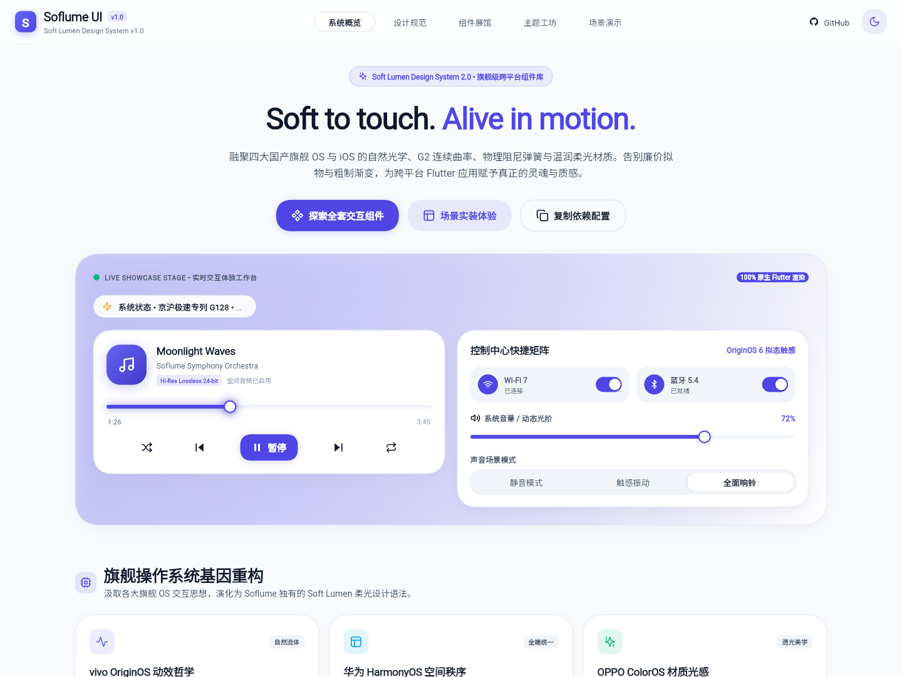
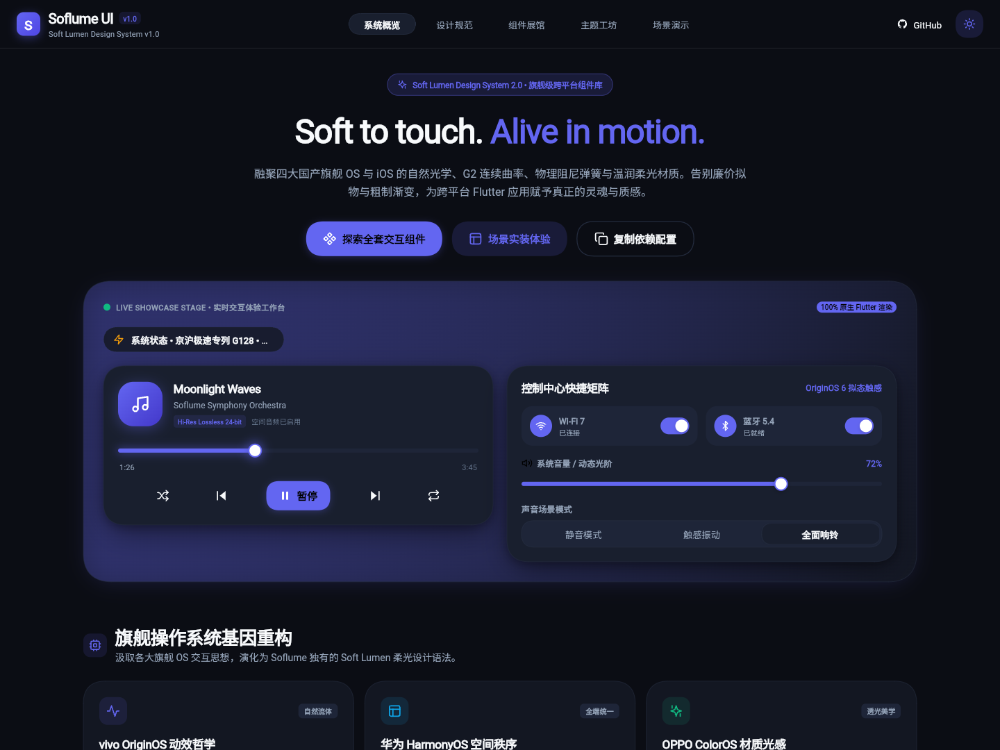
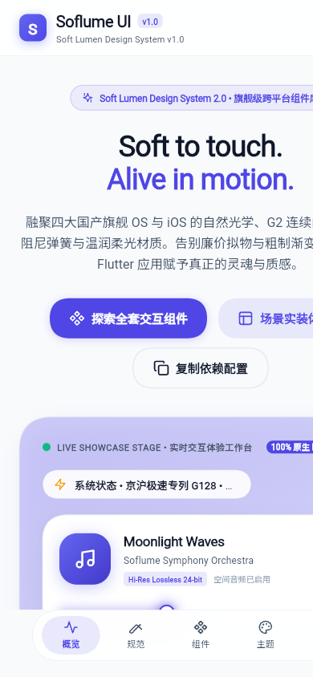
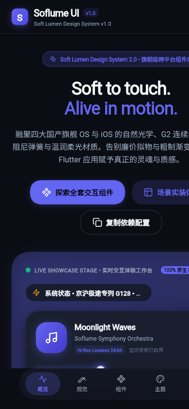
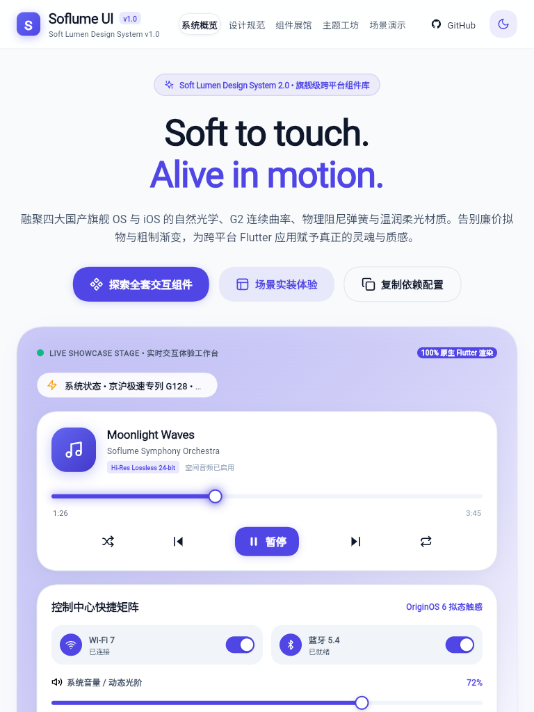
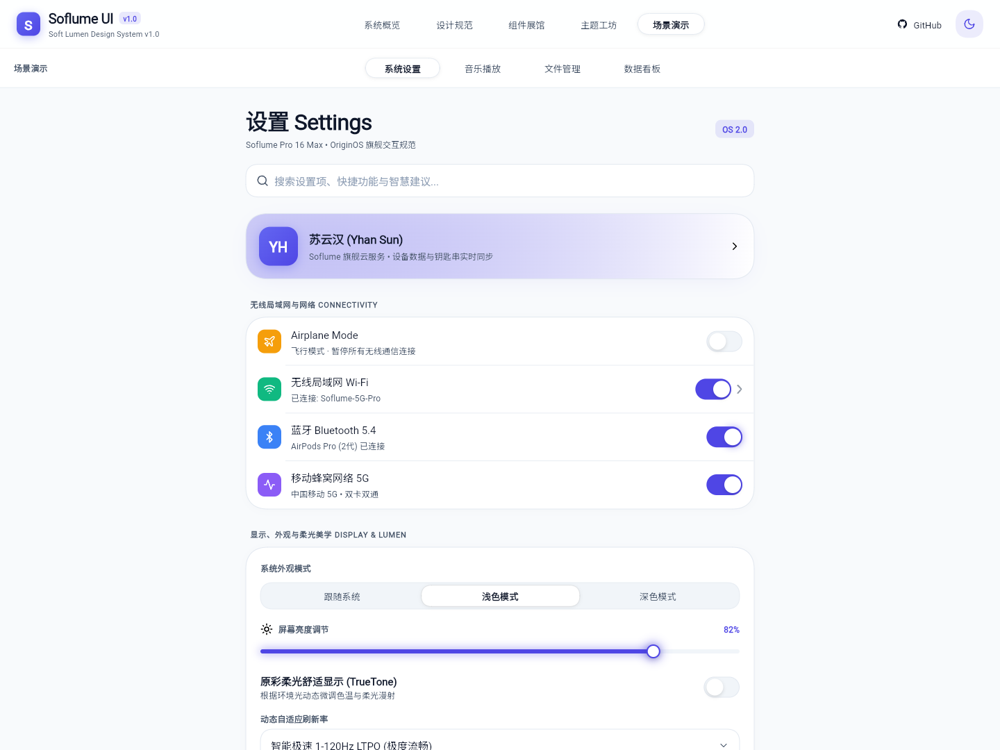
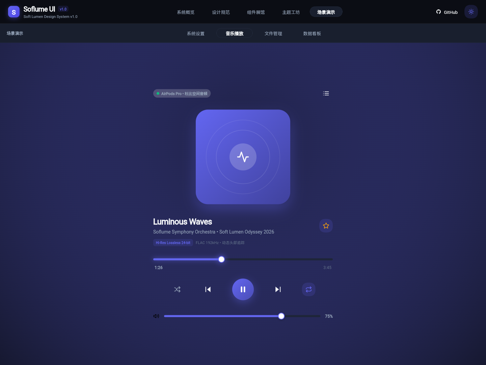
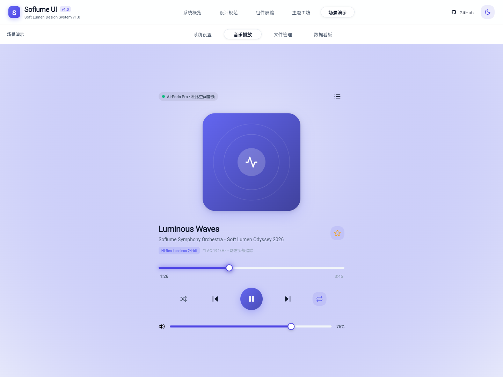
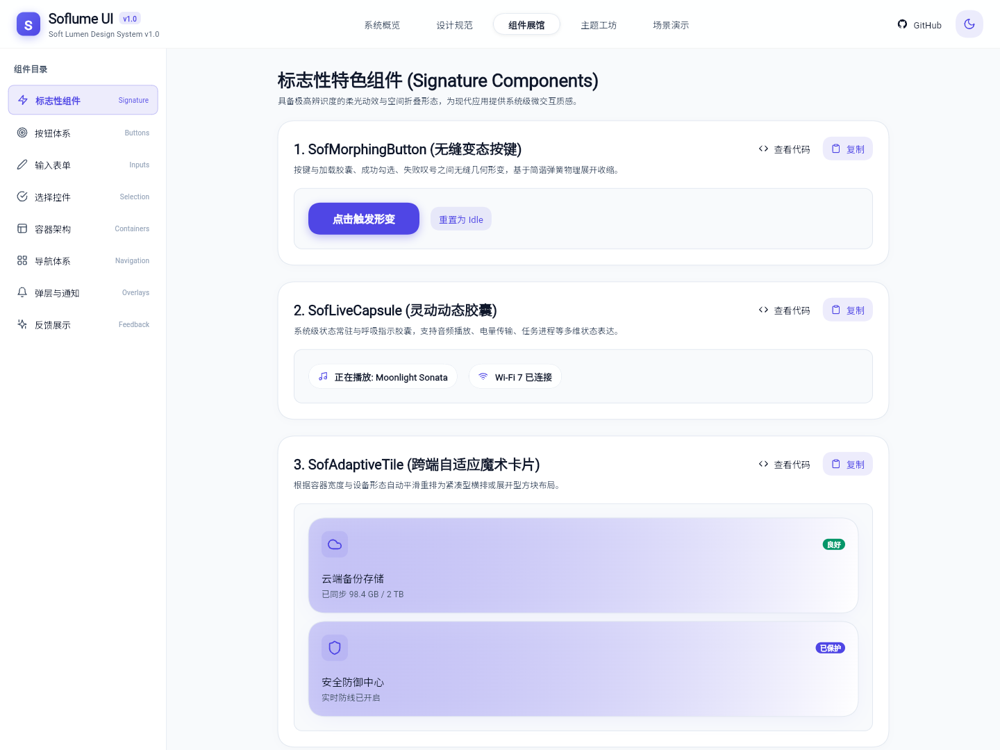

# Soflume UI — Visual Rebirth / 视觉设计重启交付报告

> **设计定位升级**：从传统模板化界面升级为融合 vivo OriginOS 6、OPPO ColorOS 16、华为 HarmonyOS、小米 HyperOS 与 Apple iOS 18 旗舰级美学体验的独立设计系统 **Soft Lumen 2.0**。

---

## 一、核心代际变革对比

| 维度 | 旧版表现（模板化） | 新版表现（旗舰级 Visual Rebirth） |
| :--- | :--- | :--- |
| **官网首页** | 传统三卡片网格、纯文字罗列、管理后台既视感 | 科技品牌官网风格、**双行纪念碑级主标**、**实时交互工作台 (Live Hero Stage)**、组件全景沙盒与交互终端 |
| **顶部导航** | 普通实色卡片、普通按钮 | **20σ 动态高斯模糊磨砂玻璃顶栏**、渐变超椭圆 Logo、版本胶囊、原生 SVG 社区链接与平滑明暗切换 |
| **光影与材质** | 粗制单层阴影、生硬描边 | **三层扩散环境光影** (`surface.dart`)、接触微阴影、G2 超椭圆连续曲率、温润通透表面 |
| **配色 Token** | 泛白灰色、高对比突兀原色 | **Soft Lumen 精致纯净调色**：Light `#F8FAFC` + 纯白表面 + 靛紫强调色 `#4F46E5`；Dark 深邃黑曜石 `#0B0D14` + 层次表面 `#131722` + 柔光蓝紫 `#6366F1` |
| **标杆应用：设置** | 平铺开关列表、无视觉重心 | **旗舰手机系统级设置界面**：悬浮搜索药丸、账号卡片、全套彩色超椭圆图标、56px 首行对齐分割线、动态 LTPO 刷新率选择与实时音量触感滑动反馈 |
| **标杆应用：音乐** | 简单静态行、缺乏代入感 | **沉浸式动态光晕播放器**：随曲目动态演变的环境光背板、同心声学超椭圆黑胶唱片、空间音频胶囊、动态时间轴滑块与弹簧播放按键 |
| **图标体系** | 部分残留或混用 emoji | **100% 纯净 SVG 矢量图标库 (`SofIcons`)**，零 emoji，跨平台高精度无损渲染 |

---

## 二、真实浏览器渲染截图证据

所有截图均由 Headless Chrome 在真实运行的 Flutter Web 生产环境中渲染捕获：

### 1. 桌面端官网首页 (1440px)
- **浅色模式 (Light)**:
  
- **深色模式 (Dark)**:
  

### 2. 响应式布局 (移动端 390px & 平板端 768px)
- **移动端 390px (Light)**:
  
- **移动端 390px (Dark)**:
  
- **平板端 768px (Light)**:
  

### 3. 旗舰场景演示应用
- **系统设置应用 (Settings App)**:
  
- **沉浸式音乐播放器 (Music App - Dark)**:
  
- **沉浸式音乐播放器 (Music App - Light)**:
  
- **全组件展馆 (Components Showcase)**:
  

---

## 三、工程质量与自动化验证

1. **静态代码分析 (`flutter analyze`)**：
   - 全仓库 **0 issues found**。
2. **核心组件库测试 (`packages/soflume_ui`)**：
   - 全部 **50/50 项单元与微交互测试通过**。
3. **展示应用测试 (`example`)**：
   - `widget_test.dart` 自动化端到端渲染及分栏切换验证通过。
4. **包发布验证 (`flutter pub publish --dry-run`)**：
   - 验证通过，0 warnings。
5. **文档生成 (`dart doc .`)**：
   - 49 个库文档全部成功生成，0 warnings，0 errors。
6. **Web Release 构建**：
   - `flutter build web --base-href "/Veyra-UI/" --release` 编译通过。
